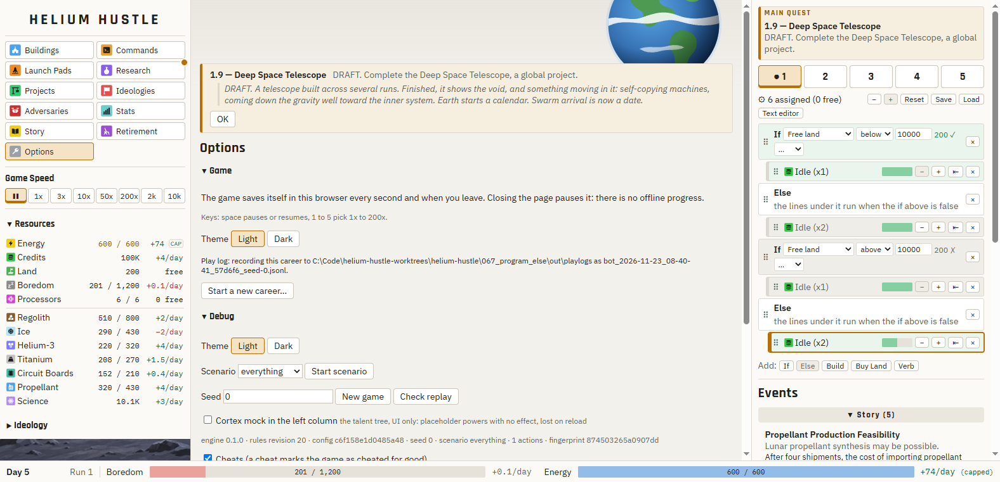

# 067: program `else`

Matt's ruling (2026-11-23): programs get `else`, one level, as `if`. Rules revision 20.

## What was built

- **Engine.** `state::Op::Else {}` (JSON `{"op":"else"}`), an unindented line after an `if`
  or its body, one per `if`; its indented lines are its body. `programs::Block` /
  `programs::blocks` is the one place that says which block a line may join (`check_line`,
  the text parser and the view's red-line reasons all use it). In `programs::step`, a false
  `if` jumps its body into the `else`'s body; reaching the `else` from the `if`'s body
  passes it free and jumps its body (marked `jumped`); a locked `if` passes both bodies.
  `locked()` holds an `else` exactly when it holds `if`.
- **Text form.** `else` alone on its line (any case); `else if ...` and `else <text>` are
  red with their reasons; a misplaced `else` is red ("an else needs an if above it", "an if
  has one else", "an else can't sit inside an if").
- **Web.** An Else row in the block view (no outcome, no indent button), an **Else** add
  button (on while the last line is an `if` or its body), and `programEdit.ts` keeping the
  shape through drags, indents and removals: an `if` moves with its `else`, an `else` never
  moves alone, a line dropped just above an `else` joins the `if`'s body, removing an `if`
  takes its `else` line. The Text editor's gutter shows an `else` line with a note's dot.
- **Sim players.** Unchanged: no agent writes a complementary guard pair now (065 removed
  the hands-off loadout's `energy below 21%` block). The Dream watch (`if bored: dream;
  filler × fill`) could become `if / else`, but that changes the pass, not a guard, and
  065 tuned `dream_fill` to the current shape. `handsoff::without_researched` keeps an
  `else` with its skipped `if`.

## Checks

- e2e section 8 (`programElse`): the typed program below shows `if >command else >command
  if >command else >command` in the block view, reads back as the engine's canonical text,
  and at 1x, after the first day, three days running read `true ran - jumped | false jumped - ran` each day.

```
if free land below 100000
  idle
else
  idle 2
if free land above 100000
  idle
else
  idle 2
```


