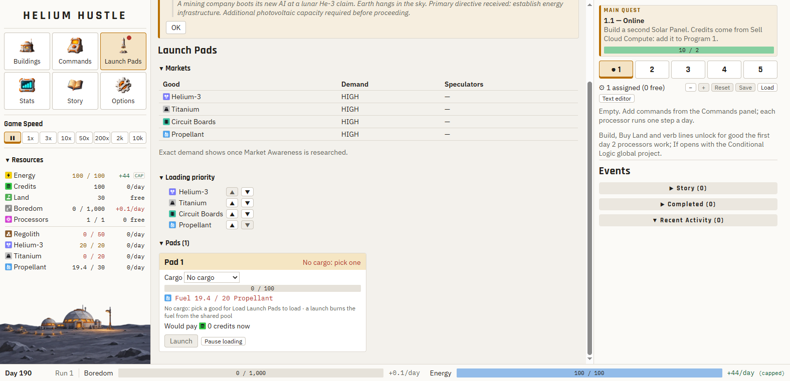

# 069: pads start with No cargo (rules 22)

Matt's ruling (2026-11-23): players must learn to pick a pad's cargo. A new Launch Pad, and
every pad a run (or a debug scenario) starts with, has **No cargo**: idle, Load Launch Pads
skips it, `idle_pads` counts it, `set pads <good> up to N` switches it. `set_pad_good` takes
`null` to return a pad to No cargo (its cargo returns as on any switch). Old saves keep their
pads' goods (a bare good reads as the pad's choice). Quest 1.2's text teaches it.

## Ladder read: main (43b18f7, rules 21) against this branch (rules 22)

`hh-sim ladder`, baseline config, seeds 1-3, careers of 20 retirements; main built with
`scripts/baseline.py`. Paired seeds. Shipments are summed over the 60 runs of each player;
"runs with a launch" counts runs with at least one.

| Player | Shipments main → branch | Runs with a launch (of 60) | Run credits main → branch |
|---|---|---|---|
| random | 0 → 0 | 0 → 0 | 1,734 → 1,734 |
| greedy | 1,195 → 1,195 | 60 → 60 | 8,857 → 8,857 |
| author | 198 → 199 | 60 → 60 | 7,836 → 7,843 |
| casual | 1,011 → 1,011 | 60 → 60 | 11,277 → 11,277 |
| handsoff | 623 → 651 | 60 → 60 | 22,109 → 22,358 |

- Every player that launched on main launches in every run on the branch. Random never
  launches, on main or here. Its programs are random lines and it never ships; its pads do
  get a cargo (`agents::pick_cargo`).
- Greedy, casual and random play the same games as on main: the ladder's pinned
  fingerprints (`PINNED`, crates/hh-sim/tests/cli.rs) didn't move. Each one points a new pad
  at He-3 at the same look the old rule did.
- The author's runs move slightly. A pad that a program builds between its looks waits at
  No cargo until the next look.
- Hands-off changed two things at once: the rule, and its loadout's new
  `set pads he3 up to 1` line, which costs a step each pass of Program 2. So its +4%
  shipments is not the rule's effect alone.

Reads: `out/069_no_cargo_pads/ladder-{main,branch}.txt` (git-ignored).
